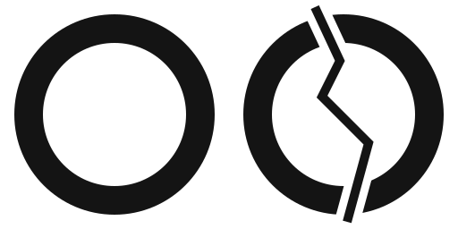
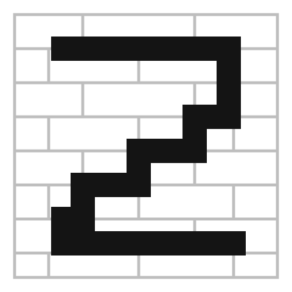
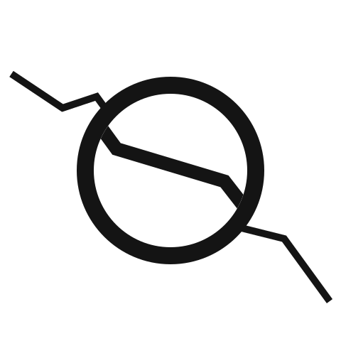
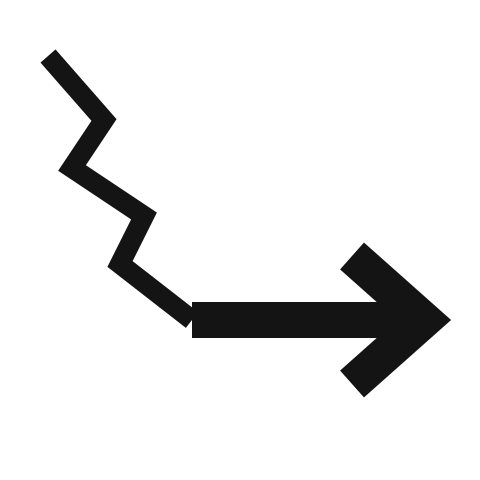

# Logo ideas (draft, 25 Oct 2026)

Four ideas for the Second Look mark. None is chosen yet; decide with the deck layout on 26 Oct.

| File | Idea |
|---|---|
|  `01_two_lenses.svg` | Two lenses for the "oo" of "look"; the second one is cracked. In the wordmark the rings replace the two o's. |
|  `02_stairstep_2.svg` | The number 2 drawn as a stair-step crack along brick courses: "second" and the brick-wall failure pattern in one mark. |
|  `03_coin_lens.svg` | The coin (our scale reference) as a lens over a crack, which appears magnified inside it. |
|  `04_crack_path.svg` | A jagged crack that straightens into an arrow: "never a permit, always a path to an engineer". |

Rules for the final mark:
- Works in one colour, in black and white, and at 32 px.
- No shields, check marks or green "OK" signs: they suggest "safe" (AGENTS.md rule 1).
- No red / yellow / green: those colours are reserved for the triage levels.

Ink `#141414` on white. Wordmark typeface in the drafts: Space Grotesk (Google Fonts, SIL Open Font License), not embedded in these files.
