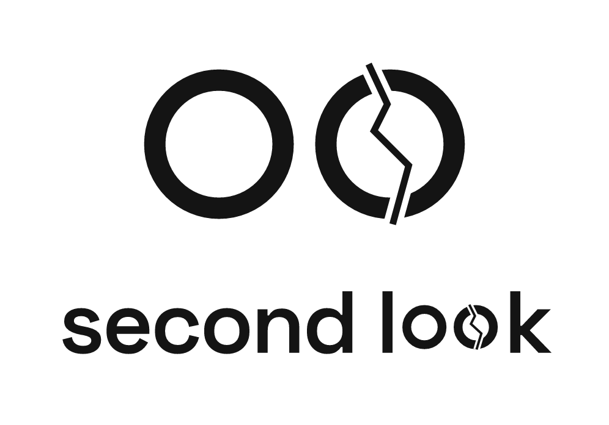
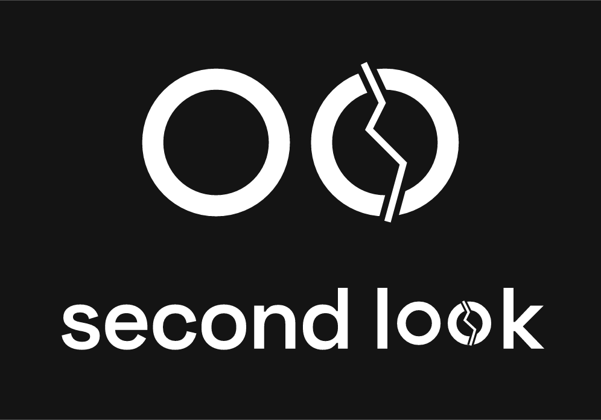
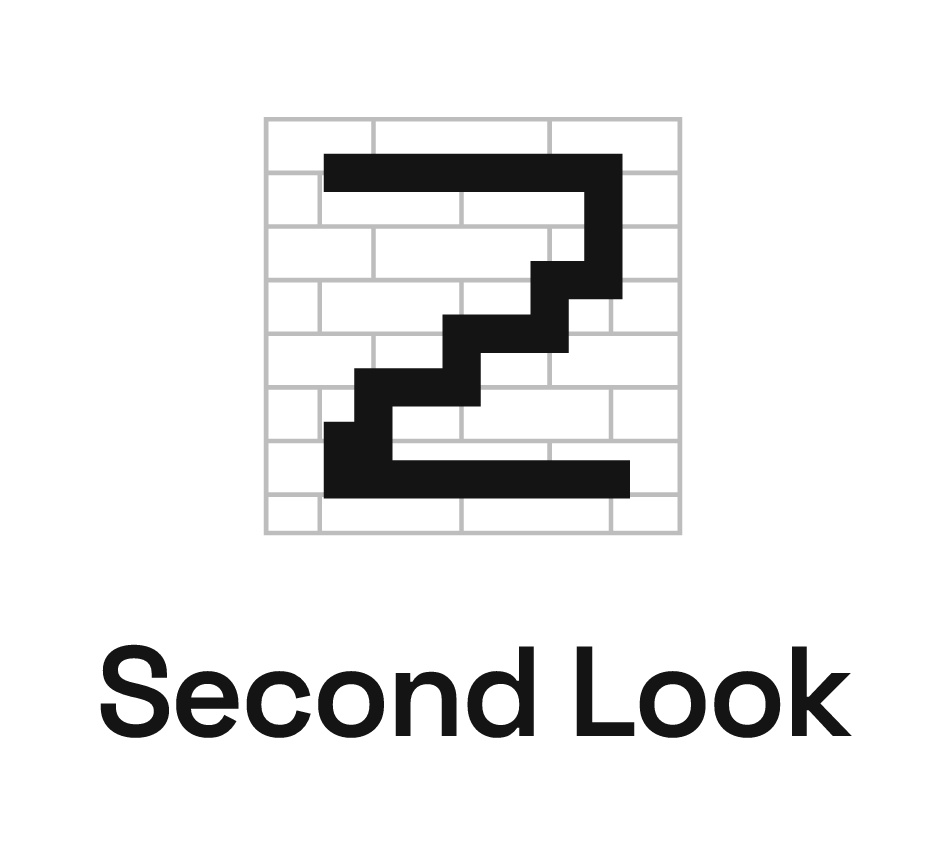
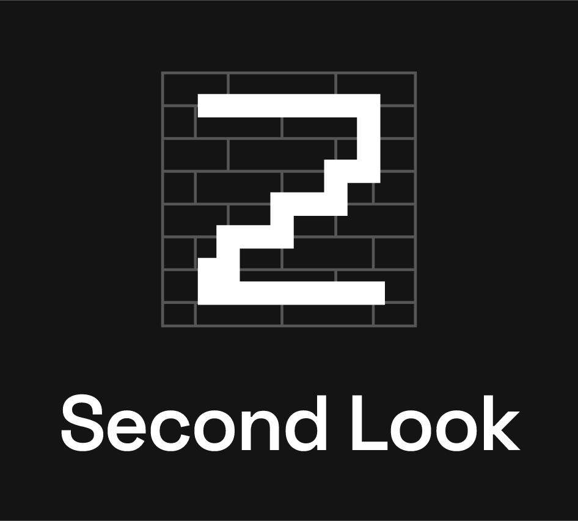
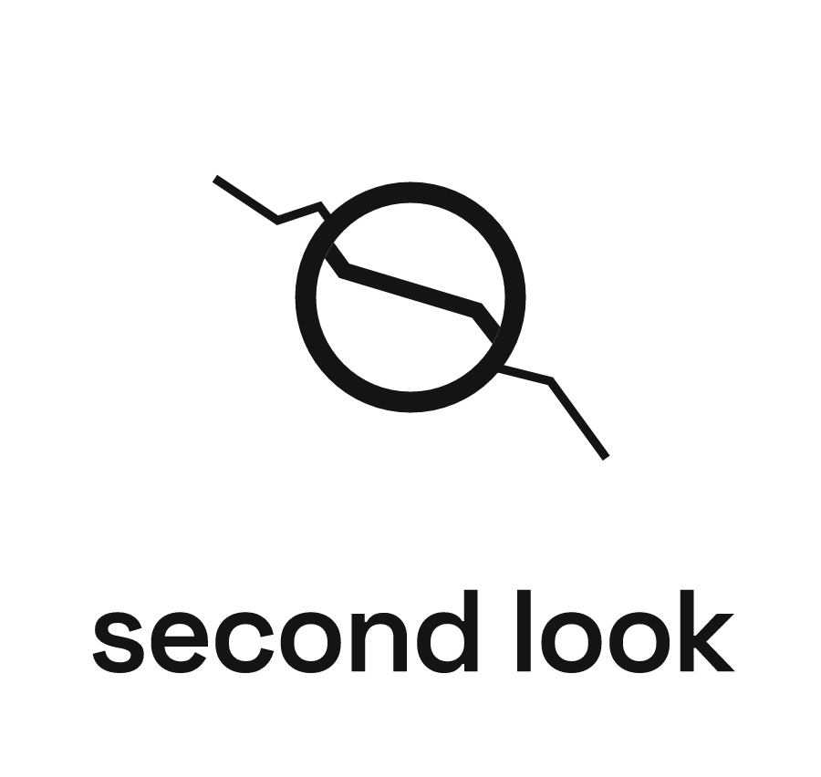
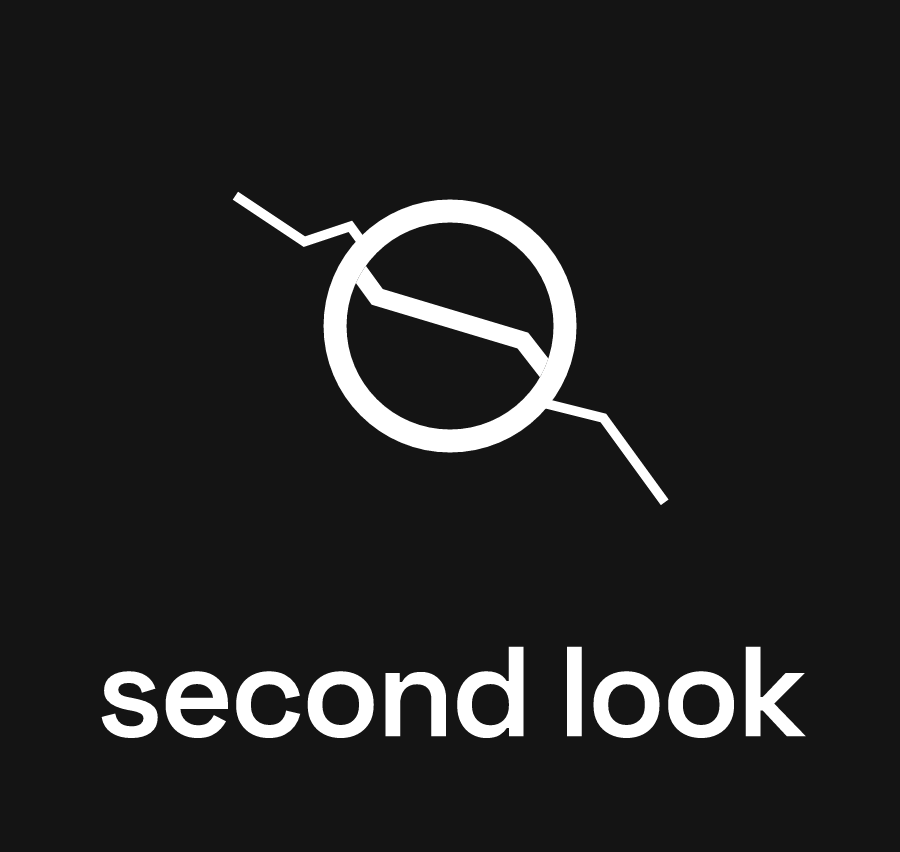
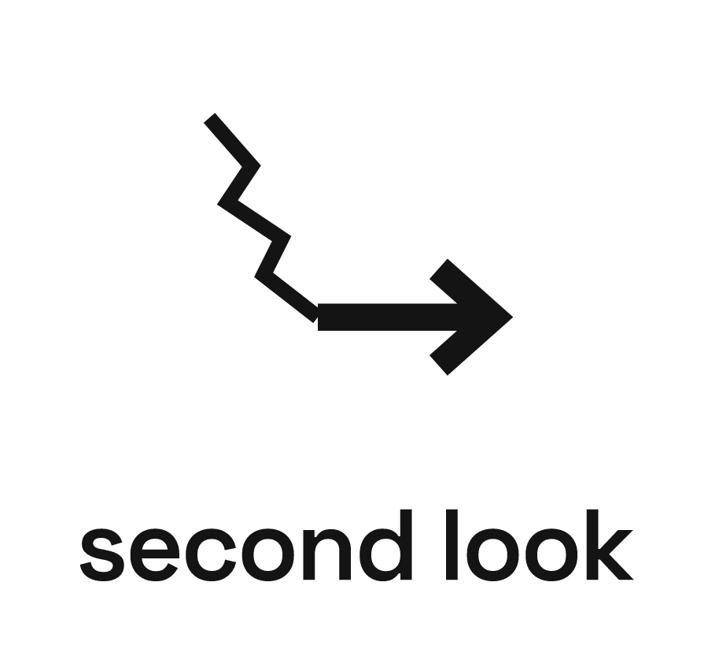
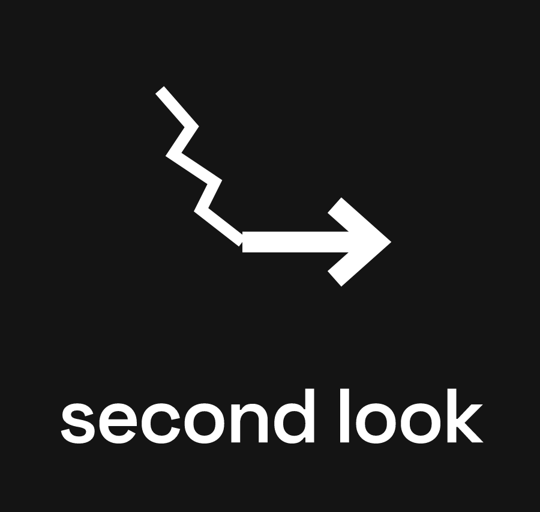

# Logo ideas (draft, 25 Oct 2026)

Four ideas for the Second Look logo. None is chosen yet; decide with the deck layout on 26 Oct.

## Logo with name (as on the logo canvas)

| Light | Dark | Idea |
|---|---|---|
|  |  | **1 · Two lenses, one cracked.** The "oo" of "look" as two lenses; the second one is cracked, also inside the wordmark. |
|  |  | **2 · Stair-step 2.** The number 2 drawn as a stair-step crack along brick courses: "second" and the brick-wall failure pattern in one mark. |
|  |  | **3 · Coin as a lens.** The coin (our scale reference) as a lens over a crack, which appears magnified inside it. |
|  |  | **4 · Crack becomes a path.** A jagged crack that straightens into an arrow: "never a permit, always a path to an engineer". |

## Files
- `0N_<idea>_lockup.svg` / `_dark.svg`: logo with name, vector, text converted to outlines (no font needed). Use these for print and slides.
- `0N_<idea>_lockup.png` / `_dark.png`: the same at 2x, for slides and documents.

Rebuild after a change: `py branding/make_lockups.py <SpaceGrotesk SemiBold .ttf>` (font from Google Fonts, SIL Open Font License; not committed).

## Rules for the final logo
- Works in one colour, in black and white, and at 32 px.
- No shields, check marks or green "OK" signs: they suggest "safe" (AGENTS.md rule 1).
- No red / yellow / green: those colours are reserved for the triage levels.

Ink `#141414`, white `#FFFFFF`. Typeface: Space Grotesk SemiBold, letter-spacing -0.03 em.
