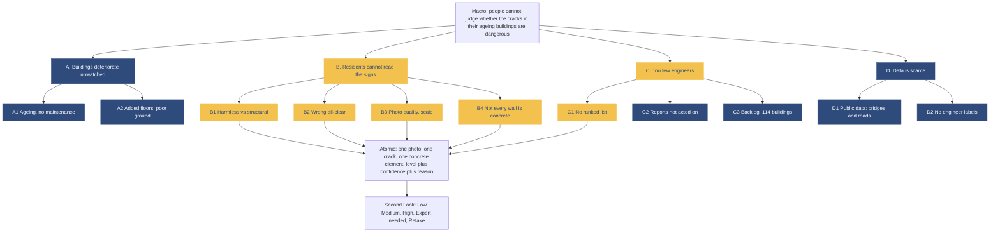

# Problem segmentation tree

Version for 29 Oct 2026. Numbers in brackets refer to `docs/sources.md`.
Only what the tool works on (`spec/decisions.md` D16). What it does not cover is stated once, in `spec/constitution/mission.md` (Out of scope).

Yellow: the path into the atomic problem. Navy: supporting context.

## Macro
People live in ageing, unsupervised buildings and cannot judge whether the cracks they see are dangerous.
1.12 billion people lived in slums or slum-like conditions in 2022, 24.8% of the world's urban population, 53.6% of urban residents in Sub-Saharan Africa [1]; 90% of slum dwellers live in Africa and Asia [2].

## Meso and micro

### A. Buildings deteriorate with nobody watching (why cracks appear)
- A1. Ageing and no maintenance: Tripoli blocks 60 to 70 years old, past their structural life [3][9].
- A2. Added floors, poor materials, poor ground: Rana Plaza, Dhaka 2013, on a filled-in pond [15].

### B. Residents see the signs but cannot read them (what the tool must solve)
- **B1.** They cannot tell a harmless surface crack from a structural one. The missing piece is interpretation, not detection.
- **B2.** A wrong all-clear lands on them: Low must be earned, any doubt goes to an expert.
- **B3.** Photos are hard to interpret: blur and light (quality gate), no scale (coin), element varies (element tag, detector).
- **B4.** Not every wall is concrete: the tool checks the material first and refers anything else to an engineer (`spec/decisions.md` D17).

### C. Engineers are too few and reports queue up (why a ranked list matters)
- **C1.** No ranked list of which building to visit first.
- C2. Reports are not acted on: the collapsed Tripoli building had been reported to a municipal call centre; engineers had not inspected it [3][7][10].
- C3. Scale of the backlog: in Tripoli, 114 buildings ordered evacuated (announced 9 Feb 2026) [3][5]; 21 evacuated, 9 under reinforcement by 16 Feb [6].

### D. Data is scarce (why we collect our own data)
- D1. Public crack data is mostly bridges, roads and pavement; almost none shows homes in informal areas. The closest, engineer surveys after the Haiti 2010 and Nepal 2015 earthquakes [41][42], rates whole buildings after a disaster, without scale (`docs/data_map.md`, section 0).
- D2. No engineer-labelled phone photos of single cracks exist yet; we collect them with our partners.

## Atomic problem (work on first)
Read one photo of one crack on one reinforced concrete element and return Low, Medium, High, "Expert needed" or "Retake", with its confidence and a one-sentence reason. It comes from B1, B2, B3, B4 and C1 (bold above).
It sits under B and C because, in four of the six cases in the deck, the danger was known; what was missing was a way to read it and to rank which building to inspect first.

## Same tree as Mermaid source

