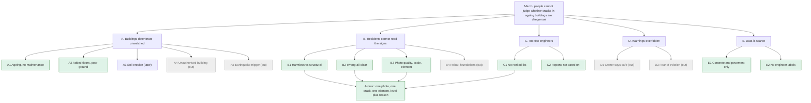

# Problem segmentation tree

Version for 29 Oct 2026. Numbers in brackets refer to `docs/sources.md`.
Scope tags: **[tool]** the tool works on it, **[later]** Phase 3, **[out]** out of scope.

## Macro
People live in ageing, unsupervised buildings and cannot judge whether the cracks they see are dangerous.
1.12 billion people lived in slums or slum-like conditions in 2022, 24.8% of the world's urban population, 53.6% of urban residents in Sub-Saharan Africa [1]; 90% of slum dwellers live in Africa and Asia [2].

## Meso and micro

### A. Buildings deteriorate with nobody watching (causes)
- A1. Ageing and no maintenance: Tripoli blocks 60 to 70 years old, past their structural life [3][9]. **[tool]**
- A2. Added floors, poor materials, poor ground: Rana Plaza, Dhaka 2013, on a filled-in pond [15]. **[tool]** for the cracks; frames **[later]**
- A3. Soil erosion and ground fissures: Buriticupu, Brazil [12]. **[later]**
- A4. Unauthorised construction: 19.6 unauthorised per 100 authorised buildings in Italy, nearly 50 in the South [19]. **[out]** (no structural records)
- A5. Earthquakes as triggers: Petrinja 2020 [20][21]. **[out]** (a trigger, not a crack signal)

### B. Residents see the signs but cannot read them (the gap the tool targets)
- B1. They cannot tell a harmless surface crack from a structural one. The missing piece is interpretation, not detection. **[tool]**
- B2. A wrong all-clear lands on them. **[tool]**: Low must be earned, any doubt goes to an expert.
- B3. Photos are hard to interpret: blur and light **[tool]** (quality gate); no scale **[tool]** (coin); element and material vary **[tool]** (element tag, YOLO).
- B4. A surface photo cannot show rebar, concrete strength or foundations. **[out]**

### C. Engineers are too few and reports queue up
- C1. No ranked list of which building to visit first. **[tool]**
- C2. Reports are not acted on: the collapsed Tripoli building had been reported to a municipal call centre; engineers had not inspected it [3][7][10]. **[tool]** (ranking)
- C3. Scale of the backlog: in Tripoli, 114 buildings ordered evacuated (announced 9 Feb 2026) [3][5]; 21 evacuated, 9 under reinforcement by 16 Feb [6]. **[tool]** (ranking)

### D. Warnings are overridden (governance)
- D1. Rana Plaza: cracks shown on TV the day before; the owner said the building was safe [15]. **[out]** (the tool informs, it cannot enforce)
- D2. Lagos: a building sealed as defective, then work resumed; 90+ collapses, 350+ deaths 2012 to 2024 [13][14]. **[out]**
- D3. Tripoli: some families refused to leave, fearing homelessness more than collapse [7]. **[out]**, but it shapes the advice: Medium means low-cost advice, not eviction.

### E. Data is scarce
- E1. Public crack data is mostly bridges, roads and pavement; almost none shows homes in informal areas (`docs/data_map.md`, section 0). **[tool]**
- E1b. The closest public data, engineer surveys after the Haiti 2010 and Nepal 2015 earthquakes [41][42], rates whole buildings after a disaster, without scale. **[tool]** (evidence and calibration only)
- E2. No engineer-labelled phone photos exist yet. **[tool]** (Phase 2)

## Atomic problem (work on first)
Read one photo of one crack on one element and return Low, Medium, High, "Expert needed" or "Retake", with a one-sentence reason (B1, B2, B3).
It sits under B because, in four of the six cases in the deck, the danger was known; what was missing was a way to rank which building to inspect first.

## Diagram

Same tree as Mermaid source:

