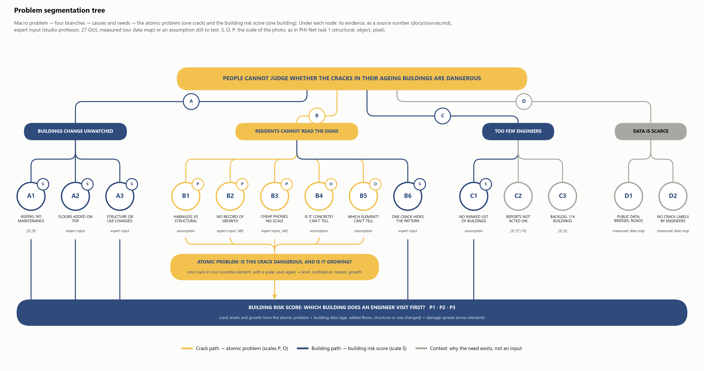
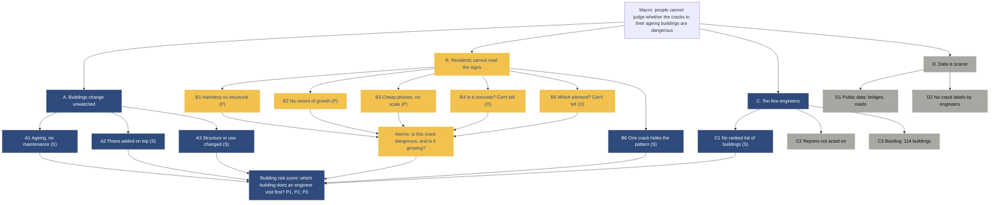

# Problem segmentation tree

Version 3, for 29 Oct 2026 (decisions D16, D21, D25). Numbers in brackets refer to `docs/sources.md`.
Only what the tool works on. What it does not cover is stated once, in `spec/constitution/mission.md` (Out of scope).

**How to read it**
- **Paths.** Yellow: the crack path, into the atomic problem. Navy: the building path, into the building risk score. Grey: context that explains why the need exists; not an input.
- **Scales.** S, O, P: the scale of the photo, as in PHI-Net task 1: S structural (the building), O object (the element), P pixel (the crack) [53][55].
- **Evidence.** Under each node: a source number; expert input (studio professor, 27 Oct); measured (our data map); or an assumption still to test.

## Macro
People cannot judge whether the cracks in their ageing buildings are dangerous.
1.12 billion people lived in slums or slum-like conditions in 2022, 24.8% of the world's urban population, 53.6% of urban residents in Sub-Saharan Africa [1]; 90% of slum dwellers live in Africa and Asia [2].

## Meso and micro

### A. Buildings change unwatched (building path, scale S)
These are the inputs of the building risk score (`spec/features/building_score.md`).

| Node | Statement | Evidence |
|---|---|---|
| A1 | Ageing, no maintenance: Tripoli blocks 60 to 70 years old, past their structural life | [3][9] |
| A2 | Floors added on top of the original building | Expert input |
| A3 | Structure or use changed: walls or columns removed, ground floor opened, housing turned into workshops | Expert input |

### B. Residents cannot read the signs (crack path, scales P and O; B6: building path)
| Node | Statement | Evidence |
|---|---|---|
| **B1** | They cannot tell a harmless crack from a structural one: the missing piece is interpretation, not detection | Assumption, to test with a short resident survey |
| **B2** | No record of growth: nobody tracks whether a crack is getting wider, which is what engineers look at above all | Expert input; growth needs repeated measurements [46] |
| **B3** | Cheap phones, no scale: a photo cannot be measured without a scale and at least 3 pixels across the crack | Expert input; [46] |
| **B4** | Is it concrete? Residents cannot tell concrete from other materials | Assumption (team, 27 Oct) |
| **B5** | Which element? Residents cannot tell a column from a beam or a wall | Assumption (team, 27 Oct) |
| B6 | One crack hides the pattern: engineers read the pattern across the whole building | Expert input |

### C. Too few engineers (building path, scale S; C2 and C3: context)
| Node | Statement | Evidence |
|---|---|---|
| C1 | No ranked list of which building to visit first | Assumption, to ask the engineering partners |
| C2 | Reports are not acted on: the collapsed Tripoli building had been reported to a municipal call centre; engineers had not inspected it | [3][7][10] |
| C3 | Backlog: in Tripoli, 114 buildings ordered evacuated (announced 9 Feb 2026); 21 evacuated, 9 under reinforcement by 16 Feb | [3][5][6] |

### D. Data is scarce (context)
| Node | Statement | Evidence |
|---|---|---|
| D1 | Public crack data is mostly bridges, roads and pavement; almost none shows homes in informal areas | Measured: `docs/data_map.md`, 13 datasets checked |
| D2 | No crack is labelled by an engineer with a risk level and a scale | Measured: `docs/data_map.md` |

## Atomic problem (work on first)
**Is this crack dangerous, and is it growing?** One crack in one reinforced concrete element, photographed with a scale and seen again later, gives a level (Low, Medium, High, Expert needed, Retake), its confidence, a one-sentence reason, and whether it grew.
It comes from the crack path: B1 to B5 (bold above).

## Building risk score (what the atomic problem feeds)
**Which building does an engineer visit first?** The crack levels and their growth, the building data (A1 to A3) and the spread of damage across elements (B6) give a priority P1, P2 or P3 (`spec/features/building_score.md`). This answers C1.

## Same tree as Mermaid source

