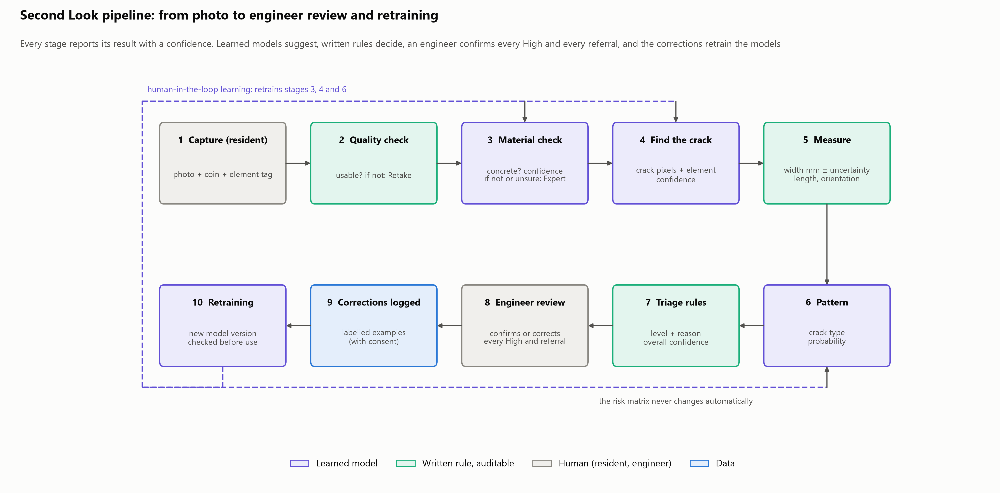
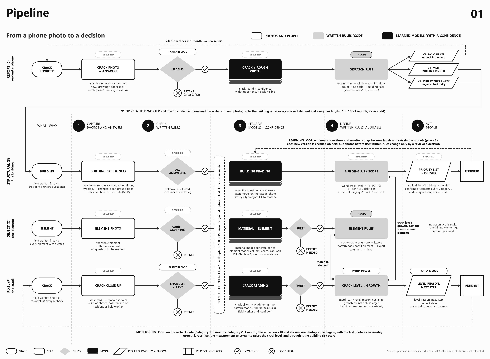
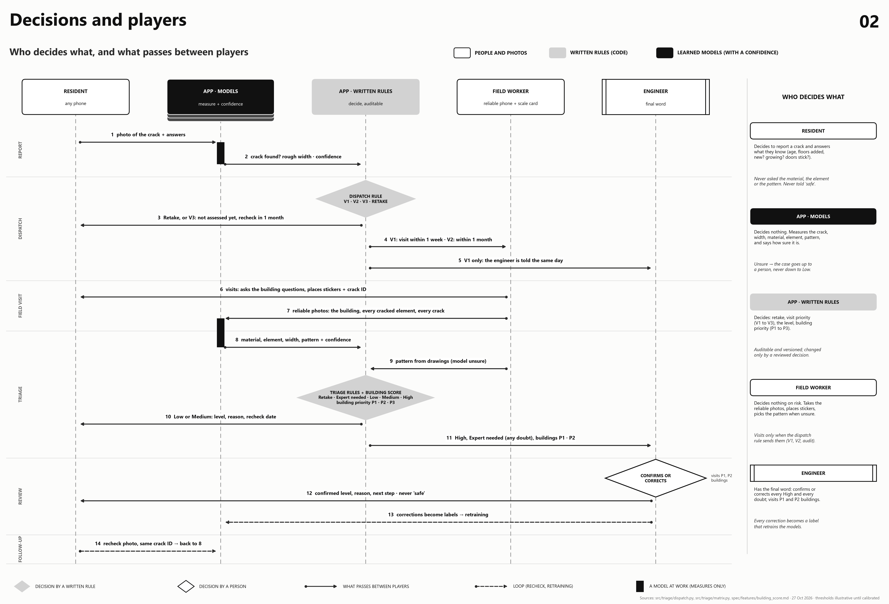
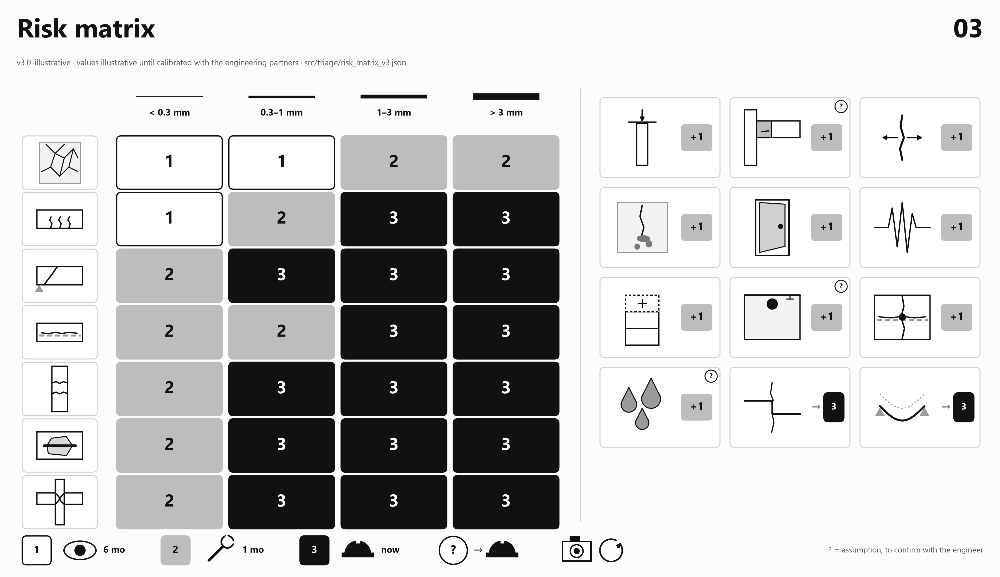
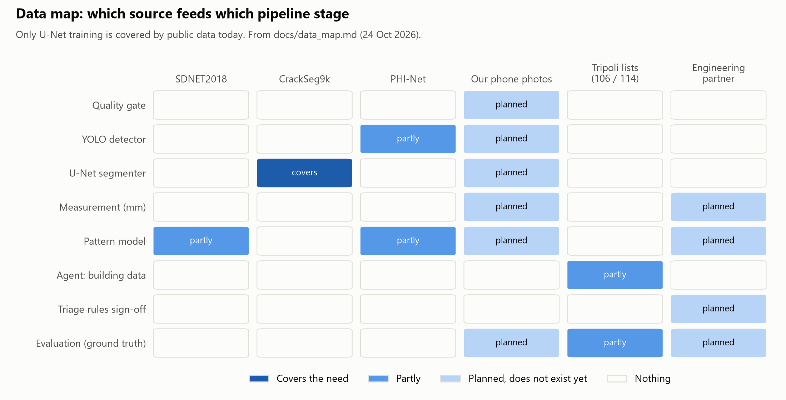
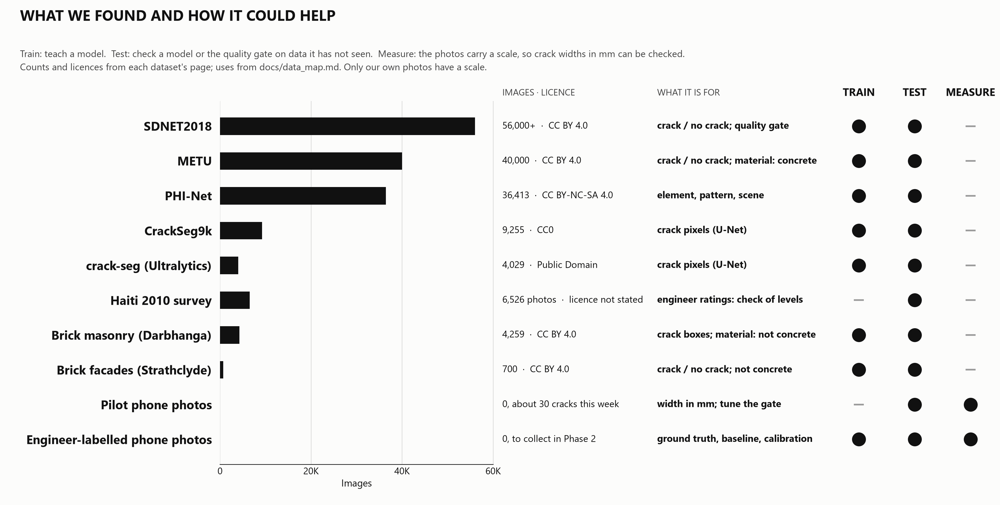
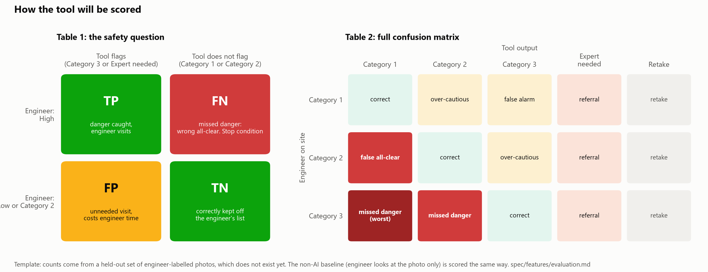
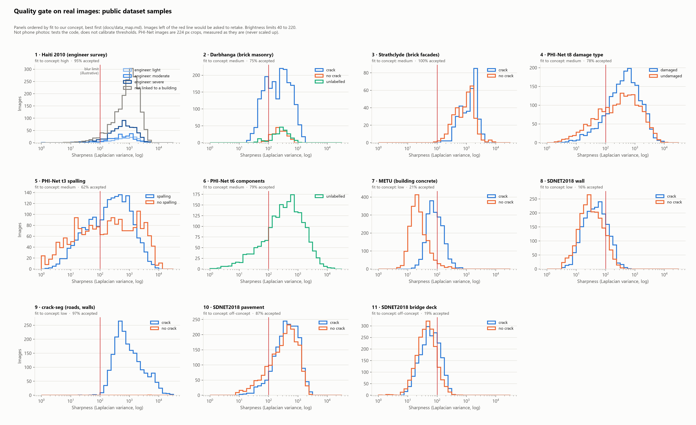
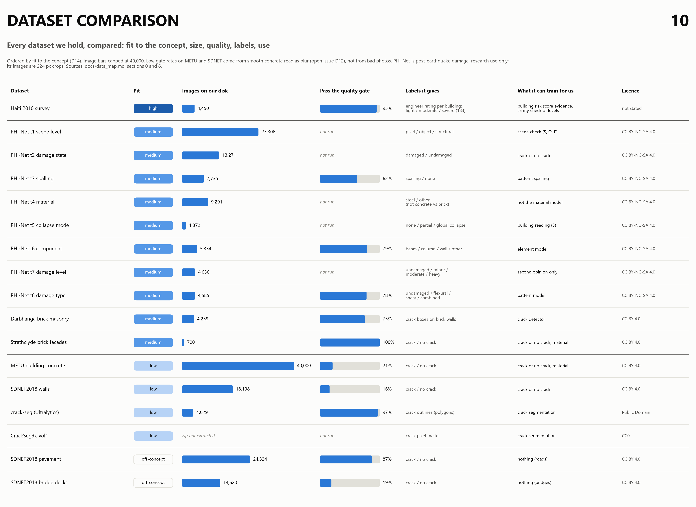

# Figures

Generated by `py src/viz/figures.py` (spec: `spec/features/figures.md`). Do not edit the PNGs by hand; change the source and rerun.

| | |
|---|---|
|  |  |
|  | |
|  |  |
|  |  |
|  |  |
|  |  |

`08_real_data_quality_gate.png` is made by `src/experiments/real_data_quality.py` (first test on real data, `docs/experiments/`).

None of these shows a measured result. Thresholds and the matrix are illustrative until calibrated with a structural engineer.
