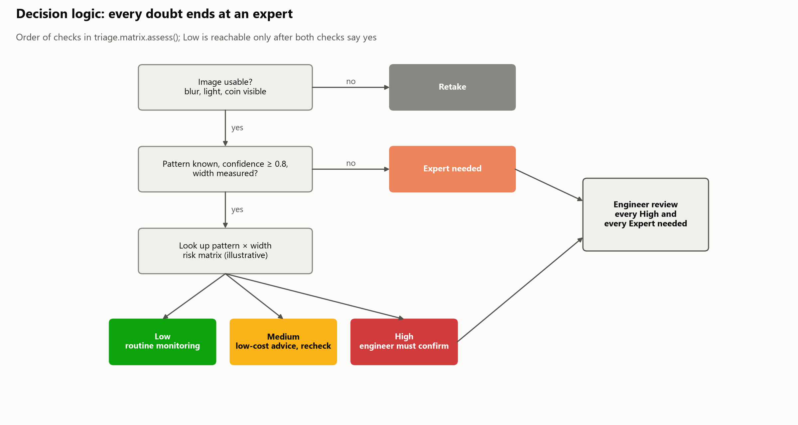

# Figures

Generated by `py src/viz/figures.py` (spec: `spec/features/figures.md`). Do not edit the PNGs by hand; change the source and rerun.

| | |
|---|---|
|  |  |
|  |  |
|  |  |
|  | |

None of these shows a measured result. Thresholds and the matrix are illustrative until calibrated with a structural engineer.
