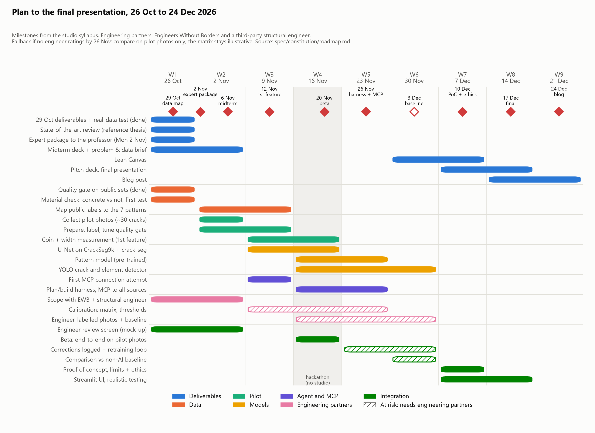

# Roadmap

1. Calibrate: agree the risk matrix and thresholds per element (columns, beams, slabs, brick walls) with structural engineers. Fix the photo protocol (coin, element tag, distance). Set consent and data rules.
2. Build and test: collect and label phone photos, train the detector and segmenter, compare against buildings an engineer has already assessed.
   Goal: flag every crack the engineer rated High, and send only a few cases to an expert.
3. Widen the scope, only if the Phase 2 goal is met: more materials, ground fissures, multi-storey frames, offline use.

## Engineering partners
- Engineers Without Borders: labelling photos, signing off the matrix and thresholds, access to assessed buildings.
- A third-party structural engineer: independent check of thresholds and of the baseline ratings. Agreement under construction.
Both are needed for every task marked "at risk" below (`spec/decisions.md` D10).

## Dates (from the syllabus, 26/27 MaAI01)
| Date | Session | Target outcome |
|---|---|---|
| 29 Oct | Segmentation tree, full data map, repo + AGENTS.md | Agent working on real data as a first test |
| 2 Nov | Expert package sent to the professor (team milestone) | Contact with the thesis author |
| 5 Nov | Midterm submission deadline | |
| 6 Nov | **Midterm presentations** | |
| 12 Nov | Full SDD constitution, first feature with tests, first MCP connection attempt | A first feature that can be measured against the baseline |
| 16 to 20 Nov | Hackathon week (no studio) | Beta version |
| 26 Nov | Full plan/build harness, MCP connectors to all mapped sources | Agent works inside defined boundaries across several live sources |
| 3 Dec | Features + tests, comparison against the non-AI method | Measurable evidence of whether the tool beats the baseline, and where it fails |
| 10 Dec | Physical/digital proof of concept; limits and ethics check; UI build | Checked against physical reality; risks and responsibilities explicit |
| 14 Dec | UI, testing in realistic conditions, narrative draft | The story matches what the system does |
| 17 Dec | **Final presentations** | Live demo + pitch |
| by 24 Dec | Blog post on blog.iaac.net (at most 1 week after the end of the studio) | |

Final deliverables: problem & data brief, project repository (with the baseline comparison), operable prototype with interface and proof of concept, Lean Canvas, final presentation with a 10-slide pitch deck (`PITCH_DECK`), IAAC blog post (`docs/BLOG_POST`).

## Plan to the final presentation (26 Oct to 24 Dec 2026)

Weeks start on Monday. "At risk" means the task depends on the engineering partners.

| Workstream | Task | Weeks | At risk |
|---|---|---|---|
| Deliverables | 29 Oct: tree, data map, repo, first real-data test (done) | 1 | |
| Deliverables | State-of-the-art review based on the reference thesis | 1 | |
| Deliverables | Expert package to the professor: review, pipeline, material test, one-page pitch (send Mon 2 Nov) | 1 | |
| Deliverables | Midterm deck and problem & data brief (submit 5 Nov) | 1 to 2 | |
| Deliverables | Lean Canvas | 6 to 7 | |
| Deliverables | 10-slide pitch deck, final presentation | 7 to 8 | |
| Deliverables | Blog post (by 24 Dec) | 8 to 9 | |
| Data | Quality gate on public sets (done) | 1 | |
| Data | Material check: concrete vs not concrete, first training test | 1 | |
| Data | Map public labels to the 7 patterns | 2 to 3 | |
| Pilot | Collect pilot photos (about 30 cracks, `spec/features/photo_protocol.md`) | 2 | |
| Pilot | Prepare, label, tune the quality gate | 2 to 3 | |
| Pilot | Coin detection and width measurement: first feature against the baseline (12 Nov) | 3 to 4 | |
| Models | U-Net on CrackSeg9k and crack-seg | 3 to 4 | |
| Models | Pattern model, pre-trained on public sets | 4 to 5 | |
| Models | YOLO crack and element detector | 4 to 6 | |
| Agent and MCP | First MCP connection attempt (12 Nov) | 3 | |
| Agent and MCP | Plan/build harness, MCP connectors to all mapped sources (26 Nov) | 4 to 5 | |
| Engineering partners | Agree scope with Engineers Without Borders and the structural engineer | 1 to 2 | |
| Engineering partners | Calibration: matrix, thresholds, protocol | 3 to 5 | yes |
| Engineering partners | Engineer-labelled photos and baseline ratings | 4 to 6 | yes |
| Integration | Engineer review screen (mock-up) | 1 to 2 | |
| Integration | Beta: end-to-end pipeline on pilot photos (hackathon) | 4 | |
| Integration | Corrections logged and retraining loop (human-in-the-loop learning) | 5 to 6 | yes |
| Integration | Comparison against the non-AI baseline (3 Dec) | 6 | yes |
| Integration | Proof of concept, limits and ethics check (10 Dec) | 7 | |
| Integration | Streamlit UI, testing in realistic conditions | 7 to 8 | |

Fallback: if no engineer ratings exist by 26 Nov, the 3 Dec comparison uses the pilot photos against our own width measurements only, the triage matrix stays illustrative, and the report says so.

## Open items
- Impact section: indicator with unit, baseline, target, evidence.
- Engineering partners: agreement with the third-party structural engineer is under construction.
